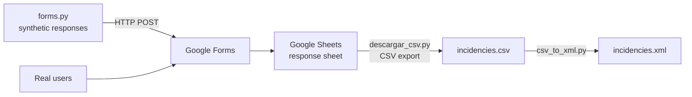

# 🛠️ IT Incident Pipeline: Google Forms → CSV → XML
 


 
> **TA04 – Group 07** · MDS (Programming and Markup Languages) · ASIX c1D
> Authors: **Alexander Valyaev** & **Gabriel Ponzi**
 
A small, end-to-end data pipeline that collects IT incident reports through **Google Forms**, exports them from **Google Sheets** as CSV, and transforms them into a clean, well-structured **XML** document.
 
The project also includes a **synthetic data generator** that floods the forms with realistic (and deliberately *chaotic*) responses, so the conversion step can be stress-tested against multilingual text, unusual Unicode, encoded values and characters that commonly break CSV/XML parsers.
 
---
 
## 📑 Table of Contents
 
- [How It Works](#-how-it-works)
- [Repository Structure](#-repository-structure)
- [Requirements](#-requirements)
- [Quick Start](#-quick-start)
- [Scripts in Detail](#-scripts-in-detail)
  - [forms.py — Synthetic response generator](#1-formspy--synthetic-response-generator)
  - [descargar_csv.py — CSV downloader](#2-descargar_csvpy--csv-downloader)
  - [csv_to_xml.py — CSV to XML converter](#3-csv_to_xmlpy--csv-to-xml-converter)
- [Data Model](#-data-model)
- [XML Output Example](#-xml-output-example)
- [Error Handling & Logging](#-error-handling--logging)
- [Authors](#-authors)
---
 
## ⚙️ How It Works
 

 
1. **Collect** — Incidents are submitted to a Google Form, either by real users or automatically by `forms.py`.
2. **Store** — Google Forms stores every response in a linked Google Sheet.
3. **Export** — `descargar_csv.py` downloads the sheet as `incidencies.csv`.
4. **Transform** — `csv_to_xml.py` parses the CSV and writes a pretty-printed `incidencies.xml`.
---
 
## 📂 Repository Structure
 
| File | Description |
|------|-------------|
| `forms.py` | Generates and submits fake incident reports to one or more Google Forms, with an optional "chaos" mode for robustness testing. |
| `descargar_csv.py` | Downloads the Google Sheets response sheet as a CSV file. |
| `csv_to_xml.py` | Converts `incidencies.csv` into a structured, indented `incidencies.xml`. |
| `incidencies.csv` | Latest export of the incident responses (raw data). |
| `incidencies.xml` | Generated XML document (≈1,250 incidents at the time of writing). |
| `.gitignore` | Excludes local artefacts such as `logform.log`. |
 
---
 
## 📋 Requirements
 
- **Python 3.8+**
- Python packages:
```bash
pip install requests faker
```
 
Optional, only if you want `forms.py` to reuse your Chromium Google session:
 
```bash
pip install browser_cookie3
```
 
> `csv_to_xml.py` uses only the Python standard library (`csv`, `xml.etree.ElementTree`, `xml.dom.minidom`).
 
---
 
## 🚀 Quick Start
 
```bash
# 1. Clone the repository
git clone https://github.com/ITB2627-PonziGabriel/TA04-g07-ValyaevAlexander-PonziGabriel-ASIXc1D.git
cd TA04-g07-ValyaevAlexander-PonziGabriel-ASIXc1D
 
# 2. Install dependencies
pip install requests faker
 
# 3. (Optional) Populate the form with test data
python3 forms.py -n 100 <GOOGLE_FORM_URL>
 
# 4. Download the latest responses as CSV
python3 descargar_csv.py
 
# 5. Convert the CSV into XML
python3 csv_to_xml.py
```
 
After step 5 you will find an up-to-date `incidencies.xml` in the project folder.
 
---
 
## 🔍 Scripts in Detail
 
### 1. `forms.py` — Synthetic response generator
 
Reads the structure of each Google Form (questions, options, validation rules, sections) directly from the public form page and submits **coherent fake answers** based on each question's title. For example, a question containing *"email"* receives an email address, *"inventari"* receives an inventory code like `INV-04213`, and *"descripció"* receives a realistic fault description.
 
**Key features**
 
- 🧠 **Context-aware answers** — detects emails, locations, inventory/serial numbers, phone numbers, names, numeric fields and descriptions (Catalan and Spanish question titles).
- ✅ **Respects form rules** — required fields, numeric validation ranges, multiple choice, dropdowns, checkboxes, scales, grids, dates, times and "Other" options.
- 🌍 **Multilingual data** — 12 locales (Catalan, Spanish, English, French, German, Italian, Portuguese, Japanese, Chinese, Russian, Arabic and Greek) via Faker.
- 🌀 **Chaos mode** — a share of free-text answers is written in other languages, other number systems (binary, hex, octal, Roman numerals, Arabic-Indic digits…), encoded (Base64, hex bytes, HTML entities, Unicode escapes) or styled with unusual Unicode (full-width, mathematical letters, zalgo, homoglyphs, zero-width spaces, emojis).
- 💣 **Markup-breaking mode** — injects fragments that typically break XML, HTML, CSV, JSON, YAML, SQL, Markdown and template engines.
- 🔁 **Resilient sending** — retries on network errors and HTTP 429 (rate limiting) with back-off.
- 🔐 **Restricted forms** — can authenticate with a `cookies.txt` file or with your Chromium session.
**Usage**
 
```bash
python3 forms.py -n 250 URL1 URL2 URL3     # 250 responses per form
python3 forms.py -n 250 -f urls.txt        # one URL per line in a file
python3 forms.py --caos 0.5 URL            # 50 % "weird" answers
python3 forms.py --caos 0 URL              # clean, normal answers only
python3 forms.py --marques 0.2 URL         # 20 % markup-breaking answers
python3 forms.py --dry-run URL             # inspect questions & sample answers, send nothing
```
 
**Options**
 
| Option | Default | Description |
|--------|---------|-------------|
| `urls` | — | One or more form URLs (`forms.gle` or `viewform`). |
| `-f`, `--fitxer` | — | Text file with one URL per line (`#` lines are ignored). |
| `-n` | `100` | Number of responses per form. |
| `--min` / `--max` | `0.5` / `1.5` | Random delay range (seconds) between submissions. |
| `--caos` | `0.3` | Proportion of "weird" free-text answers (`0` = off, `1` = all). |
| `--marques` | `0` | Proportion of answers with markup-breaking characters (`1` = extreme mode on all). |
| `--seed` | — | Random seed for reproducible results. |
| `--dry-run` | off | Analyse the form and print example answers without submitting. |
| `--cookies` | — | Netscape-format `cookies.txt` for organisation-restricted forms. |
| `--chromium` | off | Use the Google session open in Chromium (requires `browser_cookie3`). |
 
> ⚠️ This tool is intended for **testing forms you own or are authorised to use** within this academic project. Keep the delays reasonable to avoid rate limiting.
 
---
 
### 2. `descargar_csv.py` — CSV downloader
 
Downloads the Google Sheet linked to the form using its public CSV export endpoint and saves it as `incidencies.csv`.
 
```bash
python3 descargar_csv.py
```
 
To point it at a different sheet, replace `SHEET_ID` at the top of the script with the ID taken from your Google Sheets URL:
 
```
https://docs.google.com/spreadsheets/d/<SHEET_ID>/edit
```
 
> The sheet must be shared as **"Anyone with the link can view"**, otherwise the request returns an HTTP error and the script reports it.
 
---
 
### 3. `csv_to_xml.py` — CSV to XML converter
 
Reads `incidencies.csv` and builds an XML tree where each row becomes an `<incidencia>` element with an incremental `id` attribute.
 
```bash
python3 csv_to_xml.py
```
 
**What it does**
 
- **Normalises column headers into valid XML tag names** — lowercases them, removes accents (`à → a`, `ç → c`, `ñ → n`…), replaces spaces and slashes with `_`, and strips apostrophes, brackets, dots and any other non-alphanumeric characters. For example, `Descripció de la incidència` → `descripcio_de_la_incidencia`.
- **Escapes special characters safely** — values are written through `ElementTree`, so characters such as `<`, `>` and `&` are escaped automatically instead of breaking the document.
- **Trims whitespace** from every value.
- **Pretty-prints** the result with two-space indentation and UTF-8 encoding.
---
 
## 🗂️ Data Model
 
Each incident in the dataset contains the following fields:
 
| XML tag | Original column (Catalan) | Meaning |
|---------|---------------------------|---------|
| `marca_temporal` | Marca de temps | Submission timestamp |
| `data_de_la_incidencia` | Data de la incidència | Date of the incident |
| `usuari_afectat` | Usuari afectat | Person reporting / affected |
| `departament` | Departament | Department |
| `tipus_dequip` | Tipus d'equip | Device type (printer, projector…) |
| `ubicacio` | Ubicació | Location (room, office…) |
| `numero_dinventari` | Número d'inventari | Inventory number |
| `categoria_de_lavaria` | Categoria de l'avaria | Fault category |
| `descripcio_de_la_incidencia` | Descripció de la incidència | Free-text description |
| `usuaris_afectats` | Usuaris afectats | Number of affected users |
| `contacte_del_tecnic_assignat` | Contacte del tècnic assignat | Assigned technician contact |
 
---
 
## 📄 XML Output Example
 
```xml
<?xml version="1.0" ?>
<incidencies>
  <incidencia id="2">
    <marca_temporal>4/11/2026 9:27:38</marca_temporal>
    <data_de_la_incidencia>4/11/2026</data_de_la_incidencia>
    <usuari_afectat>Jo</usuari_afectat>
    <departament>Manteniment</departament>
    <tipus_dequip>Impressora</tipus_dequip>
    <ubicacio>A2</ubicacio>
    <numero_dinventari>N1</numero_dinventari>
    <categoria_de_lavaria>No identificat</categoria_de_lavaria>
    <descripcio_de_la_incidencia>...</descripcio_de_la_incidencia>
    <usuaris_afectats>...</usuaris_afectats>
    <contacte_del_tecnic_assignat>...</contacte_del_tecnic_assignat>
  </incidencia>
  <!-- ... -->
</incidencies>
```
 
---
 
## 🧯 Error Handling & Logging
 
| Script | Behaviour |
|--------|-----------|
| `forms.py` | Failed submissions (network errors, HTTP errors, login required) are appended to **`logform.log`** with a timestamp, the form URL and the payload sent. The log is excluded from Git via `.gitignore`. Progress is shown live in the terminal with ✓ / ✗ counters. |
| `descargar_csv.py` | Reports the HTTP status code if the sheet cannot be downloaded (usually a sharing-permission issue). |
| `csv_to_xml.py` | Warns if `incidencies.csv` is missing and reports any other conversion error without crashing. |
 
---
 
## 👥 Authors
 
| | Name | GitHub |
|---|------|--------|
| 👤 | **Gabriel Ponzi** | [@ITB2627-PonziGabriel](https://github.com/ITB2627-PonziGabriel) |
| 👤 | **Alexander Valyaev** | [@ITB2627-ValyaevAlexander](https://github.com/ITB2627-ValyaevAlexander) |
 
**Course:** ASIX c1D · **Module:** MDS – Programming and Markup Languages · **Activity:** TA04
