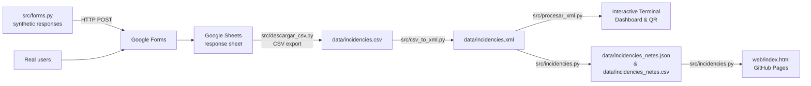
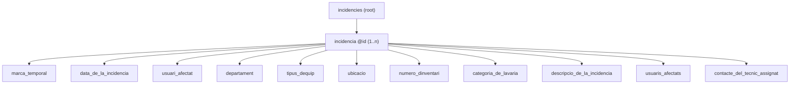

# 🛠️ IT Incident Pipeline: Google Forms → CSV → XML → JSON & Web Dashboard
 


 
> **TA04 – Group 07** · MDS (Programming and Markup Languages) · ASIX c1D
> Authors: **Alexander Valyaev** & **Gabriel Ponzi**
 
An end-to-end data pipeline that collects IT incident reports through **Google Forms**, exports them from **Google Sheets** as CSV, transforms them into a clean, well-structured **XML** document, analyses and sanitises the data to turn it into meaningful **information**, stores the cleaned dataset as **JSON** and **CSV**, and publishes an interactive, mobile-responsive **Web Dashboard** via **GitHub Pages**.
 
The project works with the *big three* data-interchange formats — **CSV, XML and JSON** — which are open, documented, Unicode-based and widely used, making them a sustainable choice for long-term data storage and reuse.
 
The project also includes a **synthetic data generator** (`src/forms.py`) that floods the forms with realistic (and deliberately *chaotic*) responses, so the conversion and cleaning steps can be stress-tested against multilingual text, unusual Unicode, encoded values (Base64, hexadecimal, octal, HTML entities, Zalgo, homoglyphs) and characters that commonly break CSV/XML parsers.
 
---
 
## 📑 Table of Contents
 
- [How It Works](#-how-it-works)
- [Repository Structure](#-repository-structure)
- [Requirements & Automated Setup](#-requirements--automated-setup)
- [Quick Start](#-quick-start)
- [Scripts in Detail](#-scripts-in-detail)
  - [src/forms.py — Synthetic response generator](#1-srcformspy--synthetic-response-generator)
  - [src/descargar_csv.py — CSV downloader](#2-srcdescargar_csvpy--csv-downloader)
  - [src/csv_to_xml.py — CSV to XML converter](#3-srccsv_to_xmlpy--csv-to-xml-converter)
  - [src/procesar_xml.py — Interactive terminal dashboard & QR](#4-srcprocesar_xmlpy--interactive-terminal-dashboard--qr)
  - [src/incidencies.py — Data cleaning, JSON/CSV export & Web generator](#5-srcincidenciespy--data-cleaning-jsoncsv-export--web-generator)
- [Web Dashboard & GitHub Pages](#-web-dashboard--github-pages)
- [Data Model](#-data-model)
- [XML Tree Diagram](#-xml-tree-diagram)
- [XML Output Example](#-xml-output-example)
- [JSON Output Example](#-json-output-example)
- [Project Stages](#-project-stages)
- [Error Handling & Logging](#-error-handling--logging)
- [Authors](#-authors)
---
 
## ⚙️ How It Works
 

 
1. **Collect** — Incidents are submitted to a Google Form, either by real users or automatically by `src/forms.py`.
2. **Store** — Google Forms stores every response in a linked Google Sheet.
3. **Export** — `src/descargar_csv.py` downloads the sheet as `data/incidencies.csv`.
4. **Transform** — `src/csv_to_xml.py` parses the CSV and writes a pretty-printed `data/incidencies.xml`.
5. **Analyse & Sanitise** — `src/procesar_xml.py` and `src/incidencies.py` read the XML in streaming mode (`iterparse`), decode obfuscated text, filter out invalid records and display interactive statistics in the terminal.
6. **Store & Publish** — Clean records are saved to `data/incidencies_netes.json` and `data/incidencies_netes.csv`, and rendered into a responsive web report (`web/index.html` / `web/informe.html`) deployed automatically to GitHub Pages.
---
 
## 📂 Repository Structure
 
| Path | Description |
|------|-------------|
| `src/forms.py` | Generates and submits fake incident reports to one or more Google Forms, with an optional "chaos" mode for robustness testing. |
| `src/descargar_csv.py` | Downloads the Google Sheets response sheet as `data/incidencies.csv`. |
| `src/csv_to_xml.py` | Converts `data/incidencies.csv` into a structured, indented `data/incidencies.xml`. |
| `src/procesar_xml.py` | Interactive console dashboard with ANSI tables, bar charts, text de-obfuscation, web launcher and terminal QR code generator. |
| `src/incidencies.py` | Full data-cleaning pipeline that exports `data/incidencies_netes.json` and `data/incidencies_netes.csv` (with overwrite/append checks) and builds the HTML dashboard from `web/plantilla.html`. |
| `data/incidencies.csv` | Latest export of the incident responses (raw data). |
| `data/incidencies.xml` | Generated XML document (~1,250+ incidents). |
| `data/incidencies_netes.json` | Cleaned and normalised incidents stored in JSON format. |
| `data/incidencies_netes.csv` | Cleaned and normalised incidents stored in CSV format. |
| `web/plantilla.html` | HTML/CSS/JS template used to generate the interactive web report. |
| `web/index.html` | Main responsive web dashboard published on GitHub Pages. |
| `web/informe.html` | Generated standalone HTML report copy. |
| `startup.sh` | Automated setup script for Linux/macOS that checks Python, installs all dependencies from `requirements.txt` and verifies imports. |
| `requirements.txt` | List of external Python packages required by the project (`requests`, `faker`, `qrcode`, `browser-cookie3`). |
| `.github/workflows/deploy.yml` | GitHub Actions workflow that automatically deploys `web/` to GitHub Pages on every push to `main`. |
| `.gitignore` | Excludes local artefacts such as `.venv/` and `logform.log`. |
 
---
 
## 📋 Requirements & Automated Setup
 
- **Python 3.8+**
- External packages listed in `requirements.txt`:
  - `requests` (downloading CSV from Google Sheets and submitting forms)
  - `faker` (multilingual synthetic data generation)
  - `qrcode` (rendering the GitHub Pages QR code directly in the terminal)
  - `browser-cookie3` *(optional, only if reusing a Chromium Google session in `src/forms.py`)*

### Automatic installation (`startup.sh`)

You can install and verify all dependencies at once using the included `startup.sh` script:

```bash
chmod +x startup.sh
./startup.sh
```

*(If your system uses an externally managed Python environment, create and activate a virtual environment first: `python3 -m venv .venv && source .venv/bin/activate && ./startup.sh`.)*

Alternatively, install manually via `pip`:

```bash
pip install -r requirements.txt
```
 
> `src/csv_to_xml.py` and `src/incidencies.py` rely solely on the Python standard library (`csv`, `xml.etree.ElementTree`, `json`, `statistics`, `unicodedata`, `webbrowser`, etc.).
 
---
 
## 🚀 Quick Start
 
```bash
# 1. Clone the repository
git clone https://github.com/ITB2627-PonziGabriel/TA04-g07-ValyaevAlexander-PonziGabriel-ASIXc1D.git
cd TA04-g07-ValyaevAlexander-PonziGabriel-ASIXc1D
 
# 2. Set up environment and install dependencies
python3 -m venv .venv && source .venv/bin/activate
chmod +x startup.sh && ./startup.sh
 
# 3. (Optional) Populate the form with synthetic test data
python3 src/forms.py -n 100 <GOOGLE_FORM_URL>
 
# 4. Download the latest responses as CSV
python3 src/descargar_csv.py
 
# 5. Convert the CSV into XML
python3 src/csv_to_xml.py
 
# 6. Clean data, export JSON/CSV and regenerate the web dashboard
python3 src/incidencies.py
 
# 7. Launch the interactive terminal dashboard (with QR code & web launcher)
python3 src/procesar_xml.py
```
 
After running steps 6 and 7, `data/incidencies_netes.json`, `data/incidencies_netes.csv`, and `web/index.html` will be up to date, and you can explore the statistics interactively in the terminal or scan the QR code on your mobile device.
 
---
 
## 🔍 Scripts in Detail
 
### 1. `src/forms.py` — Synthetic response generator
 
Reads the structure of each Google Form (questions, options, validation rules, sections) directly from the public form page and submits **coherent fake answers** based on each question's title. For example, a question containing *"email"* receives an email address, *"inventari"* receives an inventory code like `INV-04213`, and *"descripció"* receives a realistic fault description.
 
**Key features**
 
- 🧠 **Context-aware answers** — detects emails, locations, inventory/serial numbers, phone numbers, names, numeric fields and descriptions (Catalan and Spanish question titles).
- ✅ **Respects form rules** — required fields, numeric validation ranges, multiple choice, dropdowns, checkboxes, scales, grids, dates, times and "Other" options.
- 🌍 **Multilingual data** — 12 locales (Catalan, Spanish, English, French, German, Italian, Portuguese, Japanese, Chinese, Russian, Arabic and Greek) via Faker.
- 🌀 **Chaos mode** — a share of free-text answers is written in other languages, other number systems (binary, hex, octal, Roman numerals, Arabic-Indic digits…), encoded (Base64, hex bytes, HTML entities, Unicode escapes) or styled with unusual Unicode (full-width, mathematical letters, zalgo, homoglyphs, zero-width spaces, emojis).
- 💣 **Markup-breaking mode** — injects fragments that typically break XML, HTML, CSV, JSON, YAML, SQL, Markdown and template engines.
- 🔁 **Resilient sending** — retries on network errors and HTTP 429 (rate limiting) with back-off.
- 🔐 **Restricted forms** — can authenticate with a `cookies.txt` file or with your Chromium session.

**Usage**
 
```bash
python3 src/forms.py -n 250 URL1 URL2 URL3     # 250 responses per form
python3 src/forms.py -n 250 -f urls.txt        # one URL per line in a file
python3 src/forms.py --caos 0.5 URL            # 50 % "weird" answers
python3 src/forms.py --caos 0 URL              # clean, normal answers only
python3 src/forms.py --marques 0.2 URL         # 20 % markup-breaking answers
python3 src/forms.py --dry-run URL             # inspect questions & sample answers, send nothing
```
 
**Options**
 
| Option | Default | Description |
|--------|---------|-------------|
| `urls` | — | One or more form URLs (`forms.gle` or `viewform`). |
| `-f`, `--fitxer` | — | Text file with one URL per line (`#` lines are ignored). |
| `-n` | `100` | Number of responses per form. |
| `--min` / `--max` | `0.5` / `1.5` | Random delay range (seconds) between submissions. |
| `--caos` | `0.3` | Proportion of "weird" free-text answers (`0` = off, `1` = all). |
| `--marques` | `0` | Proportion of answers with markup-breaking characters (`1` = extreme mode on all). |
| `--seed` | — | Random seed for reproducible results. |
| `--dry-run` | off | Analyse the form and print example answers without submitting. |
| `--cookies` | — | Netscape-format `cookies.txt` for organisation-restricted forms. |
| `--chromium` | off | Use the Google session open in Chromium (requires `browser_cookie3`). |
 
> ⚠️ This tool is intended for **testing forms you own or are authorised to use** within this academic project. Keep the delays reasonable to avoid rate limiting.
 
---
 
### 2. `src/descargar_csv.py` — CSV downloader
 
Downloads the Google Sheet linked to the form using its public CSV export endpoint and saves it as `data/incidencies.csv`.
 
```bash
python3 src/descargar_csv.py
```
 
To point it at a different sheet, replace `SHEET_ID` at the top of the script with the ID taken from your Google Sheets URL:
 
```text
https://docs.google.com/spreadsheets/d/<SHEET_ID>/edit
```
 
> The sheet must be shared as **"Anyone with the link can view"**, otherwise the request returns an HTTP error and the script reports it.
 
---
 
### 3. `src/csv_to_xml.py` — CSV to XML converter
 
Reads `data/incidencies.csv` and builds an XML tree where each row becomes an `<incidencia>` element with an incremental `id` attribute (`data/incidencies.xml`).
 
```bash
python3 src/csv_to_xml.py
```
 
**What it does**
 
- **Normalises column headers into valid XML tag names** — lowercases them, removes accents (`à → a`, `ç → c`, `ñ → n`…), replaces spaces and slashes with `_`, and strips apostrophes, brackets, dots and any other non-alphanumeric characters. For example, `Descripció de la incidència` → `descripcio_de_la_incidencia`.
- **Escapes special characters safely** — values are written through `ElementTree`, so characters such as `<`, `>` and `&` are escaped automatically instead of breaking the document.
- **Trims whitespace** from every value.
- **Pretty-prints** the result with two-space indentation and UTF-8 encoding.
---
 
### 4. `src/procesar_xml.py` — Interactive terminal dashboard & QR
 
A console dashboard that reads `data/incidencies.xml` in streaming mode (`ET.iterparse`), automatically locates the dataset regardless of the working directory, and presents an **interactive menu** where the user can inspect individual statistical blocks:

```bash
python3 src/procesar_xml.py                 # automatically locates data/incidencies.xml
python3 src/procesar_xml.py ruta/al.xml     # uses a custom XML path
```

**Data cleaning & de-obfuscation** — before computing metrics, corrupted or anomalous records are filtered out and obfuscated text is decoded:
- Decodes Base64, hexadecimal byte strings, binary bitstrings, HTML entities (`&#...;`), Unicode escapes (`\u...`), Mojibake, Zalgo combining marks and homoglyphs.
- Filters out impossible or out-of-range dates (e.g. `0296` or `2064`), non-numeric or unrealistic affected-user counts (`1..500`), empty/garbage mandatory fields and duplicate entries.

**Interactive menu blocks** — statistics are organised into selectable sections with ANSI colours, Unicode box-drawing tables and horizontal bar charts, plus direct actions to **open the web dashboard in the browser** or **render a terminal QR code** pointing to the live GitHub Pages site.

---
 
### 5. `src/incidencies.py` — Data cleaning, JSON/CSV export & Web generator
 
Processes `data/incidencies.xml`, exports the cleaned dataset to **`data/incidencies_netes.json`** and **`data/incidencies_netes.csv`**, and injects the processed data into `web/plantilla.html` to produce **`web/index.html`** and **`web/informe.html`**.

```bash
python3 src/incidencies.py
```

Before writing `data/incidencies_netes.json`, the program checks whether the file already exists:
 
| Situation | Behaviour |
|-----------|-----------|
| File does **not** exist | It is created with all cleaned incidents. |
| File exists → **Overwrite** | Previous content is deleted and all incidents are written again. |
| File exists → **Append** | Existing incidents are kept and only **new** ones are added, avoiding duplicates (incidents with the same `id` are never repeated). |
 
```text
The file 'data/incidencies_netes.json' already exists. What do you want to do?
  [1] Overwrite it
  [2] Append new incidents
>
```
 
---

## 🌐 Web Dashboard & GitHub Pages

The `web/` directory contains a responsive, self-contained HTML/CSS/JS dashboard (`web/index.html` and `web/informe.html`) designed with clean cards, KPI summaries, interactive filters, search and mobile adaptation.

- **Automatic Deployment:** Every push to `main` triggers `.github/workflows/deploy.yml`, publishing `web/` to **GitHub Pages**:
  `[https://itb2627-ponzigabriel.github.io/TA04-g07-ValyaevAlexander-PonziGabriel-ASIXc1D/](https://itb2627-ponzigabriel.github.io/TA04-g07-ValyaevAlexander-PonziGabriel-ASIXc1D/)`
- **Mobile QR Access:** Both the interactive terminal menu (`src/procesar_xml.py`) and the web interface allow generating/scanning a QR code to open the dashboard directly on a smartphone.

---
 
## 🗂️ Data Model
 
Each incident in the dataset contains the following fields:
 
| XML tag | Original column (Catalan) | Meaning |
|---------|---------------------------|---------|
| `marca_temporal` | Marca de temps | Submission timestamp |
| `data_de_la_incidencia` | Data de la incidència | Date of the incident |
| `usuari_afectat` | Usuari afectat | Person reporting / affected |
| `departament` | Departament | Department |
| `tipus_dequip` | Tipus d'equip | Device type (printer, projector…) |
| `ubicacio` | Ubicació | Location (room, office…) |
| `numero_dinventari` | Número d'inventari | Inventory number |
| `categoria_de_lavaria` | Categoria de l'avaria | Fault category |
| `descripcio_de_la_incidencia` | Descripció de la incidència | Free-text description |
| `usuaris_afectats` | Usuaris afectats | Number of affected users |
| `contacte_del_tecnic_assignat` | Contacte del tècnic assignat | Assigned technician contact |
 
---
 
## 🌳 XML Tree Diagram
 

 
---
 
## 📄 XML Output Example
 
```xml
<?xml version="1.0" ?>
<incidencies>
  <incidencia id="2">
    <marca_temporal>4/11/2026 9:27:38</marca_temporal>
    <data_de_la_incidencia>4/11/2026</data_de_la_incidencia>
    <usuari_afectat>Jo</usuari_afectat>
    <departament>Manteniment</departament>
    <tipus_dequip>Impressora</tipus_dequip>
    <ubicacio>A2</ubicacio>
    <numero_dinventari>N1</numero_dinventari>
    <categoria_de_lavaria>No identificat</categoria_de_lavaria>
    <descripcio_de_la_incidencia>...</descripcio_de_la_incidencia>
    <usuaris_afectats>...</usuaris_afectats>
    <contacte_del_tecnic_assignat>...</contacte_del_tecnic_assignat>
  </incidencia>
  <!-- ... -->
</incidencies>
```
 
---
 
## 📄 JSON Output Example
 
```json
[
  {
    "id": "2",
    "marca_temporal": "4/11/2026 9:27:38",
    "data_de_la_incidencia": "4/11/2026",
    "usuari_afectat": "Jo",
    "departament": "Manteniment",
    "tipus_dequip": "Impressora",
    "ubicacio": "A2",
    "numero_dinventari": "N1",
    "categoria_de_lavaria": "No identificat",
    "descripcio_de_la_incidencia": "...",
    "usuaris_afectats": 2,
    "contacte_del_tecnic_assignat": "..."
  }
]
```
 
---
 
## ✅ Project Stages
 
| Stage | Task | Status |
|-------|------|--------|
| F1 | Incident form + CSV data collection (`src/forms.py`, `src/descargar_csv.py`) | ✅ Done |
| F2 | CSV → XML conversion + XML tree diagram (`src/csv_to_xml.py`) | ✅ Done |
| F3 | Interactive terminal statistics + data de-obfuscation (`src/procesar_xml.py`) | ✅ Done |
| F4 | Clean JSON/CSV export with duplicate checks (`src/incidencies.py`) | ✅ Done |
| F5 | Responsive Web Dashboard, QR code access & GitHub Pages deployment | ✅ Done |
 
---
 
## 🧯 Error Handling & Logging
 
| Script | Behaviour |
|--------|-----------|
| `src/forms.py` | Failed submissions (network errors, HTTP errors, login required) are appended to **`logform.log`** with a timestamp, the form URL and the payload sent. The log is excluded from Git via `.gitignore`. Progress is shown live in the terminal with ✓ / ✗ counters. |
| `src/descargar_csv.py` | Reports the HTTP status code if the sheet cannot be downloaded (usually a sharing-permission issue). |
| `src/csv_to_xml.py` | Warns if `data/incidencies.csv` is missing and reports any other conversion error without crashing. |
| `src/procesar_xml.py` | Automatically searches `data/incidencies.xml` relative to the project root, handles missing `qrcode` gracefully with installation instructions and catches XML syntax errors cleanly. |
 
---
 
## 👥 Authors
 
| | Name | GitHub |
|---|------|--------|
| 👤 | **Gabriel Ponzi** | [@ITB2627-PonziGabriel](https://github.com/ITB2627-PonziGabriel) |
| 👤 | **Alexander Valyaev** | [@ITB2627-ValyaevAlexander](https://github.com/ITB2627-ValyaevAlexander) |
 
**Course:** ASIX c1D · **Module:** MDS – Programming and Markup Languages · **Activity:** TA04